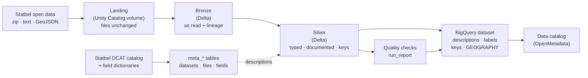

# Statbel Lakehouse — a data governance demo, from open data to BigQuery

[](https://creativecommons.org/licenses/by-nc/4.0/)


A small, reproducible pipeline that loads **Belgian official statistics**
([Statbel open data](https://statbel.fgov.be/en/open-data)) into **Google
BigQuery** through a **Databricks** lakehouse — with the metadata a data
catalog needs: table and column descriptions, primary and foreign keys,
labels, licence attribution, lineage and data quality checks.

It is the **physical layer of a training** on *mapping physical data to a
business glossary*, for Data Owners and Data Stewards. The tables are then
harvested by a data catalog (OpenMetadata) where the exercise takes place.

> **Built by [Olivier Bouchez](https://olivier-bouchez.com) — Data Governance
> consultant.** I help organisations set up data ownership, business
> glossaries, data catalogs and data quality that people actually use. This
> repository shows, on real public data, the kind of foundations I put in
> place. Interested? Get in touch through
> **[olivier-bouchez.com](https://olivier-bouchez.com)**.

---

## What it does



| Step | Notebook | Result |
|---|---|---|
| Setup | `00_setup` | Unity Catalog schema and volumes, your settings (outside git), connection checks |
| Catalog | `01_statbel_catalog` | Statbel DCAT catalog → `meta_dataset`, `meta_distribution`, `meta_document`, `meta_field` (4,000+ field descriptions read from ~200 Excel dictionaries with ~50 layouts) |
| Load | `02_load_statbel` | landing → bronze → silver for the tables enabled in [`config/datasets.yml`](config/datasets.yml), quality checks, Unity Catalog documentation and keys |
| Publish | `03_publish_bigquery` | silver → BigQuery: data, descriptions, labels, primary and foreign keys, `GEOGRAPHY`, run report |
| Tag | `04_governance_tags` | Unity Catalog tags: business domain, personal data, licence, representation of each column |
| Catalog access | `05_openmetadata_access` | read-only rights for the OpenMetadata Unity Catalog connector ([docs/openmetadata.md](docs/openmetadata.md)) |
| Answer key | `06_training_answer_key` | trainer only: each silver column ↔ suggested business term of the [glossary](glossary/README.md) (64 % of the columns), written outside git and outside the catalog |
| Catalog page | `07_catalog_page` | one self-contained web page of the Statbel catalog: search on datasets, files and field names; field descriptions in EN/FR/NL/DE |
| Glossary files | `08_glossary_import_files` | [`glossary/terms.yml`](glossary/terms.yml) → OpenMetadata import files (two passes), each term mapped to the Statbel columns it explains |
| Learn | `tutorial/01-03` | the same method, step by step, by hand, for two tables |

The **business glossary** (5 glossaries, 127 terms, OpenMetadata 2.0 import
files) is in [`glossary/`](glossary/README.md). OpenMetadata harvests both
**Databricks** (Unity Catalog connector: tables, tags, column lineage) and
**BigQuery**; participants then link columns to terms — the exercise.

## Data governance, built in

| Practice | How it is done here |
|---|---|
| **Configuration, not code** | every table is an entry of `config/datasets.yml` (sources, filters, types, keys, dictionary); no table-specific code |
| **Documentation from the source** | column descriptions come from the Statbel field dictionaries (`meta_field`), else from the configuration; a gap is written *"Description missing in the Statbel dictionary"* — never hidden |
| **Keys that are tested** | a primary key is declared only if it is unique and never NULL; foreign keys are declared after all loads; orphan rows are counted, never dropped |
| **Quality report** | row counts, duplicate keys, NULL keys, null rate and distinct values of codes, values that could not be typed, values marked "not available" — table `run_report` in Databricks and BigQuery |
| **Lineage** | bronze keeps `_source_file`, `_source_url`, `_ingested_at`; Delta history and Unity Catalog lineage |
| **Licence and attribution** | every table description ends with *"Source: Statbel open data, CC BY 4.0"*; labels `source`, `licence`, `domain`, `period`, `layer` |
| **Least privilege, no secrets in git** | BigQuery is written by a service account that is *Data Editor* on one dataset only; its key lives in a Databricks secret scope; personal settings live in a volume, outside the repository |

## Tables

Naming: `ref_` reference data, `pop_` persons and population, `eco_`
enterprises, `mob_` mobility, `bld_` built environment. Statbel column names
are kept (`CD_` code, `TX_` label, `MS_` measure, `DT_` date…) so that the
mapping exercise works on real physical names.

| Table | Content | Key | Status |
|---|---|---|---|
| `ref_municipality` | administrative units (region › province › district › municipality) | `CD_REFNIS` | enabled |
| `ref_nuts_lau` | REFNIS ↔ NUTS ↔ LAU (European regions) | `CD_LAU` | enabled |
| `ref_statistical_sector` | 20,000 statistical sectors with their boundary (`GEOGRAPHY`) | `CD_SECTOR` | enabled |
| `ref_nace_bel` | economic activity classification Nace-Bel 2008 | `CD_NACEBEL` | enabled |
| `ref_first_name` | first names by municipality and sex | municipality, sex, name | enabled |
| `ref_family_name` | family names by municipality | — (*not unique in the source!*) | enabled |
| `pop_structure` | population by municipality, nationality, marital status, age, sex | 5 columns | enabled |
| `pop_by_sector` | population by statistical sector | `CD_SECTOR` | enabled |
| `pop_income_by_sector` | fiscal income by sector, 2005-2023 | year, sector | enabled |
| `eco_vat_enterprise` | VAT-liable enterprises by municipality, activity, legal form | 3 columns | enabled |
| `eco_bankruptcy` | monthly bankruptcies | 7 columns | enabled |
| `mob_road_accident` | road accidents with casualties | 7 columns | enabled |
| `bld_building_stock` | cadastral building stock (latest year) | 4 columns | enabled |
| `ref_address` | 5+ million addresses with coordinates | 3 columns | off (size: check first) |
| `ref_country` | countries (EU authority table) | `CD_COUNTRY` | off (source to confirm) |

The relations between tables are drawn in [docs/data_model.md](docs/data_model.md).
What the quality checks found in the real data — a key that is not unique,
codes for "unknown", merged municipalities — is in
[docs/data_quality_findings.md](docs/data_quality_findings.md): good material
for a governance discussion.

## Get started

1. **Create a free Databricks workspace** — [docs/databricks_free_edition.md](docs/databricks_free_edition.md)
2. **Install the project** (Google Cloud, secret, Git folder, run the notebooks) — [docs/install.md](docs/install.md)
3. **Choose the tables** — [docs/configuration.md](docs/configuration.md)

Everything runs on **Databricks Free Edition** (serverless) and stays within
the **BigQuery free tier** for the enabled tables (a size guard refuses
tables above a limit you set).

## Repository layout

```
config/
  datasets.yml               the Statbel tables to load and how (in git)
  environment.example.yml    template of your settings (the real file is
                             written by 00_setup in a Databricks volume)
glossary/   business glossary: terms.yml, its generator and the
            OpenMetadata 2.0 import files (2 passes)
openmetadata/  connector configurations (placeholders, no secrets)
notebooks/
  00_setup  01_statbel_catalog  02_load_statbel  03_publish_bigquery
  04_governance_tags  05_openmetadata_access  06_training_answer_key
  07_catalog_page     08_glossary_import_files
  assets/   page template, EU data themes
  lib/      config · common · dictionary · transform · bigquery · governance
  tutorial/ 01_ref_municipality · 02_publish_ref_municipality · 03_ref_first_name
docs/       install, Databricks Free Edition, configuration, architecture,
            data model, data quality findings, source inspection
databricks.yml               optional: the pipeline as a Databricks job
```

Notebooks are stored as Databricks *source* files (`.py`): readable in
GitHub, without outputs or data, and PEP 8 compliant.

## Licence and disclaimer

© 2026 Olivier Bouchez. Content and code licensed under
[CC BY-NC 4.0](https://creativecommons.org/licenses/by-nc/4.0/): free for
non-commercial use, with attribution. See [LICENSE](LICENSE).

The code is offered **as is**, for **demonstration, training and testing**
only, without warranty. You run it in your own accounts, at your own risk and
cost.

**Data:** Statbel open data, [CC BY 4.0](https://creativecommons.org/licenses/by/4.0/),
downloaded at run time (not stored in this repository). This project is not
affiliated with Statbel.

This repository is read-only for visitors: issues and suggestions are
welcome; changes are made by the author only.
