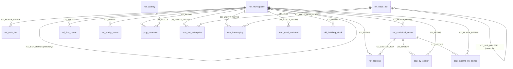

# Data model

The tables form a small connected model around the **municipality**
(`ref_municipality.CD_REFNIS`), the **statistical sector**
(`ref_statistical_sector.CD_SECTOR`) and the **economic activity**
(`ref_nace_bel.CD_NACEBEL`). Keys are declared in Unity Catalog and BigQuery
as *NOT ENFORCED* (informational): the pipeline tests them and reports
duplicates and orphan rows in `run_report`.

## Foreign keys

| From table.column | To table.column | Meaning |
|---|---|---|
| `ref_municipality.CD_SUP_REFNIS` | `ref_municipality.CD_REFNIS` | hierarchy: municipality › district › province › region |
| `ref_nuts_lau.CD_MUNTY_REFNIS` | `ref_municipality.CD_REFNIS` | European region of a municipality |
| `ref_statistical_sector.CD_MUNTY_REFNIS` | `ref_municipality.CD_REFNIS` | sector belongs to a municipality |
| `ref_address.CD_REFNIS` | `ref_municipality.CD_REFNIS` | address lies in a municipality |
| `ref_address.CD_SECTOR_2024` | `ref_statistical_sector.CD_SECTOR` | address lies in a sector |
| `ref_first_name.CD_REFNIS`, `ref_family_name.CD_REFNIS` | `ref_municipality.CD_REFNIS` | names counted by municipality |
| `pop_structure.CD_REFNIS` | `ref_municipality.CD_REFNIS` | residents of a municipality |
| `pop_structure.CD_NATLTY` | `ref_country.CD_COUNTRY` | nationality (when `ref_country` is enabled) |
| `pop_by_sector.CD_SECTOR`, `pop_income_by_sector.CD_SECTOR` | `ref_statistical_sector.CD_SECTOR` | figures per neighbourhood |
| `pop_by_sector.CD_REFNIS`, `pop_income_by_sector.CD_MUNTY_REFNIS` | `ref_municipality.CD_REFNIS` | figures per municipality |
| `eco_vat_enterprise.CD_MUNTY_REFNIS`, `eco_bankruptcy.CD_MUNTY_REFNIS` | `ref_municipality.CD_REFNIS` | enterprises by municipality |
| `eco_vat_enterprise.CD_NACE`, `eco_bankruptcy.CD_NACE_REV2_CLASS` | `ref_nace_bel.CD_NACEBEL` | activity of the enterprise |
| `ref_nace_bel.CD_SUP_NACEBEL` | `ref_nace_bel.CD_NACEBEL` | Nace-Bel hierarchy |
| `mob_road_accident.CD_MUNTY_REFNIS` | `ref_municipality.CD_REFNIS` | place of the accident |
| `bld_building_stock.CD_REFNIS` | `ref_municipality.CD_REFNIS` | buildings by administrative unit |

The real column names differ from table to table (`CD_REFNIS`,
`CD_MUNTY_REFNIS`) for the same business concept: a typical finding of a
glossary mapping exercise.
